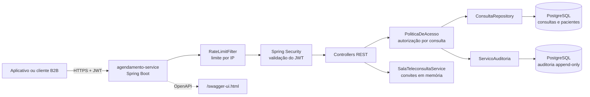
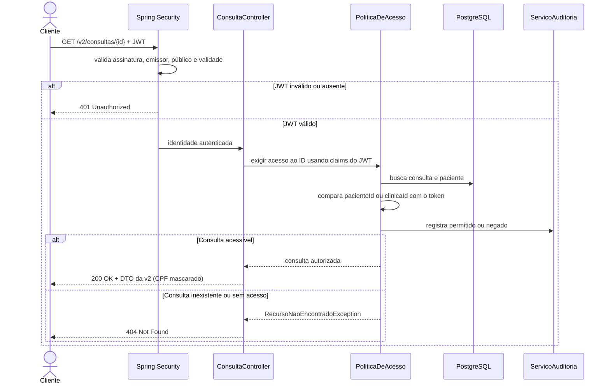
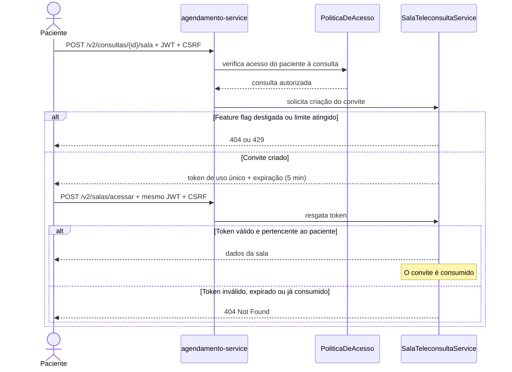
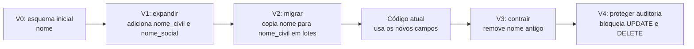

# ConectaSaúde — serviço de agendamento

Este repositório contém um **protótipo didático de uma API segura para consultas e teleconsultas**. O foco é mostrar, na prática, autorização em nível de objeto (BOLA), evolução de API, auditoria, feature flags e migrações de banco.

> **Importante:** o código implementa o serviço de agendamento deste estudo de caso, não a plataforma completa da ConectaSaúde. Não há integração real com clínicas, prontuário, faturamento, provedor de vídeo ou provedor de identidade. A sala de teleconsulta é representada por um convite temporário em memória.

## O que o serviço faz hoje

- Autentica chamadas por JWT validado como OAuth2 Resource Server.
- Permite consultar uma consulta pela API v1 ou v2, depois de verificar se o paciente ou a clínica tem acesso àquele registro.
- Registra os resultados dessas verificações na tabela de auditoria.
- Cria e resgata convites de uso único para teleconsulta, quando a feature flag está habilitada.
- Aplica um limite básico de requisições por endereço IP.
- Documenta a API com OpenAPI/Swagger e mantém testes unitários e de integração com MockMvc.

### Visão da arquitetura



## Requisitos e execução local

Você precisa de **Java 17 ou superior**, **Maven** e **PostgreSQL 14 ou superior**. Crie previamente um banco chamado `conecta_saude` e um usuário com permissão de acesso. As migrações Flyway são executadas ao iniciar o serviço.

Configure a conexão e os dados esperados do provedor JWT. Os valores de banco mostrados abaixo são exemplos locais; substitua-os pelos da sua instalação:

```sh
export DATABASE_URL=jdbc:postgresql://localhost:5432/conecta_saude
export DATABASE_USERNAME=conecta
export DATABASE_PASSWORD='sua-senha-local'
export JWT_JWK_SET_URI=https://seu-provedor/.well-known/jwks.json
export JWT_ISSUER=https://seu-provedor/
export JWT_AUDIENCE=agendamento-service

mvn spring-boot:run
```

O token deve conter:

| Claim | Uso |
|---|---|
| `sub` | UUID do usuário autenticado |
| `roles` | Papel `PACIENTE` ou `CLINICA` |
| `clinic_id` | UUID da clínica, obrigatório para chamadas como clínica |
| `iss` e `aud` | Validação do emissor e do público esperados |
| `iat` e `exp` | Validação de validade e duração máxima de 15 minutos |

As chaves públicas para verificar a assinatura são obtidas do endereço configurado em `JWT_JWK_SET_URI`. Em ambiente real, configure TLS no proxy/ingress e use segredos próprios para o ambiente — não coloque credenciais no repositório.

## Endpoints disponíveis

| Método e rota | O que faz | Observações |
|---|---|---|
| `GET /v1/consultas/{id}` | Retorna a consulta com CPF completo | Legada; responde com `Deprecation` e `Sunset` |
| `GET /v2/consultas/{id}` | Retorna a consulta com CPF mascarado | Versão recomendada |
| `POST /v2/consultas/{id}/sala` | Cria convite temporário de teleconsulta | Requer feature flag ligada e acesso à consulta |
| `POST /v2/salas/acessar` | Resgata o convite e retorna os dados da sala | O mesmo paciente autenticado só pode resgatá-lo uma vez |
| `GET /csrf` | Obtém o token CSRF | Envie-o no header `X-CSRF-TOKEN` nas requisições de alteração |
| `/swagger-ui.html` | Abre a documentação interativa | `/v3/api-docs` fornece o documento OpenAPI |

As rotas de consulta retornam apenas uma consulta por identificador; o projeto **não implementa neste momento** cadastro, criação ou listagem de agendamentos.

## Fluxo principal: autorização contra BOLA

Autenticação responde “quem está fazendo a chamada?”. Autorização em nível de objeto responde “essa pessoa pode acessar **esta consulta**?”. Validar o JWT não substitui a segunda verificação.



O serviço responde `404` tanto para um recurso inexistente quanto para um recurso sem autorização, evitando revelar sua existência. A decisão é centralizada em `PoliticaDeAcesso`, e o identificador do usuário vem do `sub` assinado, não de um parâmetro controlado pelo cliente.

## Fluxo de teleconsulta



O convite é armazenado **em memória**, expira em cinco minutos e só pode ser resgatado pelo paciente ao qual foi vinculado. O limite padrão é de três convites simultâneos por clínica. Como o armazenamento não é compartilhado, convites não são adequados para múltiplas instâncias nem persistem após reiniciar o serviço. O projeto não cria uma conexão de vídeo real.

Para habilitar a funcionalidade:

```sh
export FEATURE_TELECONSULTA_ENABLED=true
```

A flag tem responsável e data de remoção documentados em [`docs/feature-flags.md`](docs/feature-flags.md).

## Segurança e auditoria

- **JWT:** valida assinatura por JWKS, emissor, público, timestamps e duração máxima de 15 minutos.
- **Autorização por objeto:** pacientes acessam somente suas consultas; usuários `CLINICA` acessam apenas consultas da clínica indicada em `clinic_id`.
- **CSRF:** obtenha o token em `GET /csrf` e envie `X-CSRF-TOKEN` em `POST`, `PUT`, `PATCH` e `DELETE`.
- **Rate limiting:** padrão de 100 requisições por minuto por endereço IP, configurável por `RATE_LIMIT_REQUESTS_PER_MINUTE`. O contador é local à instância.
- **Dados de resposta:** DTOs separados mantêm o CPF completo na v1 e o CPF mascarado na v2.
- **Auditoria:** a autorização registra acesso permitido ou negado; convites também geram registros. A migração `V4` impede `UPDATE` e `DELETE` na tabela de auditoria no PostgreSQL.

O rate limiting e os convites são implementações simples para o protótipo: não são distribuídos entre instâncias. A regra de auditoria cobre os fluxos descritos acima, e não deve ser interpretada como auditoria completa de toda operação futura.

Para mais contexto da decisão de autorização, consulte [`docs/adr/ADR-001-autorizacao-nivel-objeto.md`](docs/adr/ADR-001-autorizacao-nivel-objeto.md).

## Evolução do esquema: expandir e contrair

As migrações mostram a separação do nome antigo em `nome_civil` e `nome_social`:



| Migração | Etapa | Efeito |
|---|---|---|
| `V0__schema_inicial.sql` | Esquema inicial | Cria pacientes, consultas e auditoria com o campo `nome` |
| `V1__expandir_nome.sql` | Expandir | Adiciona `nome_civil` e `nome_social` |
| `V2__migrar_nome.sql` | Migrar | Copia o nome existente para `nome_civil` em lotes de até 1.000 registros |
| `V3__remover_nome_antigo.sql` | Contrair | Remove a coluna `nome` antiga |
| `V4__proteger_auditoria.sql` | Proteção | Impede alterações e exclusões na auditoria |

O código atual lê os novos campos. Em implantação real, as etapas precisam ser coordenadas com as versões da aplicação e com backup; veja [`docs/execucao.md`](docs/execucao.md) antes de planejar uma reversão.

## Testes

Execute a suíte existente com:

```sh
mvn test
```

Os testes usam H2 em memória e MockMvc, sem exigir PostgreSQL ou um provedor JWT real. Eles cobrem, entre outros cenários:

- tentativa de BOLA: paciente A recebe `404` ao acessar a consulta de B e a tentativa negada é auditada;
- diferenças entre CPF da v1 e CPF mascarado da v2, incluindo os headers de depreciação;
- convite de teleconsulta vinculado ao paciente e consumido uma única vez;
- presença das versões da API na especificação OpenAPI.

## Onde encontrar cada parte

| Caminho | Conteúdo |
|---|---|
| `src/main/java/.../consulta` | Entidade, repositório, controller e DTOs de consulta |
| `src/main/java/.../acesso` | Identidade do JWT, política de acesso e resposta `404` |
| `src/main/java/.../auditoria` | Registro e persistência da auditoria |
| `src/main/java/.../teleconsulta` | Endpoints e serviço de convites |
| `src/main/java/.../config` | Segurança, CSRF, OpenAPI e rate limiting |
| `src/main/resources/db/migration` | Migrações Flyway |
| `src/test/java` | Testes de integração e contrato |
| `docs/` | Instruções adicionais, feature flags e ADR |
